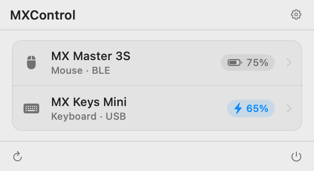
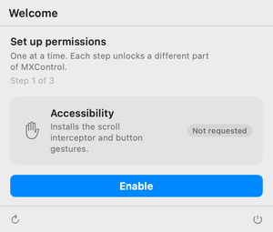
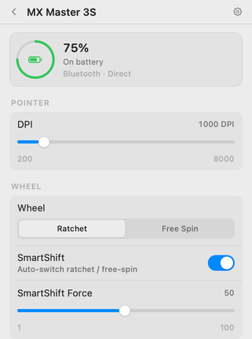
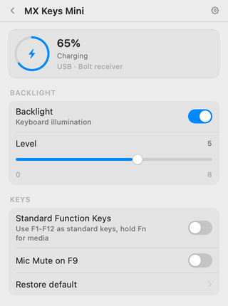

# MXControl

<p align="center">
  <picture>
    <source media="(prefers-color-scheme: dark)" srcset="docs/images/preview-dark.png">
    
  </picture>
</p>

A native macOS menu bar app that controls Logitech MX devices. Built because Logi Options+ is a 500MB Electron app that needs its own login system, phones home constantly, shows you ads for other Logitech products inside a mouse driver, and somehow uses more RAM than Xcode. For a mouse. And a keyboard.

MXControl is about 6MB on disk. It talks HID++ 2.0 directly to your devices, scroll data included. Logi Options+ still routes scroll through macOS and calls it a day. No account, no telemetry, no upsell banners, no "SmartActions" nobody asked for.

This entire thing was vibe coded. Claude wrote most of it. I pointed at things and said "fix that" until it worked. If it breaks, that's the risk you accept when a human and an LLM collectively decide they've had enough of Logi Options+.

> **0.4.0 is a from-scratch rewrite.** The bundle ID changed from `com.mxcontrol.app` to `com.wiscaksono.mxcontrol`, so macOS treats this as a new app. Re-grant permissions and expect settings not to migrate. The 0.3.x line is frozen at [v0.3.1](https://github.com/wiscaksono/MXControl/tree/v0.3.1).

## What it does

**Mouse (MX Master 3S)**

- Smooth scroll via HID++ hi-res data (15x resolution, skips the macOS scroll pipeline)
- Scroll acceleration that actually matches trackpad feel
- Wheel mode aware: snappy in ratchet, glidy in free-spin, auto-detects SmartShift switches
- Cmd+scroll zoom works (Figma, Chrome, the usual suspects)
- SmartShift wheel mode (ratchet/free-spin) with auto-disengage
- Natural scrolling and thumb wheel inversion
- Thumb button gestures: click for Mission Control, drag left/right to switch workspaces, drag up for Mission Control, drag down for App Exposé
- Battery level and charging status
- Easy-Switch host info
- Advanced: DPI, SmartShift force, scroll speed, momentum, thumb wheel speed

**Keyboard (MX Keys Mini)**

- Backlight toggle and brightness
- Fn key inversion (media keys vs F1-F12)
- Mic mute on F9 with an on-screen pill
- Battery level and charging status
- Easy-Switch host info

**Transport**

- USB via Bolt/Unifying receiver (auto-probes devices 1-6)
- Bluetooth Low Energy direct (no receiver needed)
- Both at the same time, USB preferred when duplicate detected

**App**

- Native SwiftUI menu bar popover
- First-run wizard for Accessibility, Input Monitoring, and Bluetooth, with a Relaunch step when macOS needs a fresh process
- Launch at login toggle
- Hide the menu bar icon until you open the app again
- Low battery alerts with a configurable threshold
- Settings persist and re-apply on reconnect
- About 6MB on disk, no Electron, no web view

## What it doesn't do

- Custom gesture actions (hardcoded to Mission Control, workspace switch, and App Exposé)
- Gesture tuning sliders (thresholds are fixed at 200ms and 200 units)
- Per-app settings or "SmartActions" (and honestly, good)
- Auto-update (download the DMG for now)
- Flow notifications (you don't need your mouse driver congratulating you)
- Logitech account login (lol)

## Supported devices

Tested and working:

- MX Master 3S (mouse, USB + BLE)
- MX Keys Mini (keyboard, USB + BLE)

Other Logitech HID++ 2.0 devices connected via a Bolt or Unifying receiver fall back to the generic descriptor: battery and, when the device reports it, Easy-Switch. Those are untested. BLE direct needs the device PID registered in code, so only the two above get the full feature set wirelessly without a receiver.

## Install

Grab `MXControl.dmg` from [Releases](https://github.com/wiscaksono/MXControl/releases), open it, drag to Applications.

On first open, the wizard asks for:

- **Accessibility** (scroll interception and thumb gestures)
- **Input Monitoring** (HID++ device access)
- **Bluetooth** (direct BLE devices)

Nothing is requested at launch, and no prompt appears before you open the popover. If macOS says a grant needs a restart, the wizard offers a Relaunch button.

The DMG is signed with an Apple Development certificate and is not notarized. If macOS blocks the first launch on another Mac, open **System Settings → Privacy & Security → Open Anyway**, or run:

```sh
xattr -dr com.apple.quarantine /Applications/MXControl.app
```

<p align="center">
  
</p>

Or build it yourself:

```
git clone https://github.com/wiscaksono/MXControl.git
cd MXControl
make dmg
```

Needs macOS 15+ and a Swift 6.2 toolchain (Xcode 26+). For development, `make verify` is the gate: build, tests, self-check, snapshots, and lint.

## Requirements

- macOS 15.0+
- Logitech MX device with HID++ 2.0 support
- Bolt/Unifying USB receiver or Bluetooth Low Energy

## Screenshots

<p align="center">
  
  
</p>

Screenshots are rendered from the snapshot harness (`make screenshots`), not hand-taken.

## License

MIT. See [LICENSE](LICENSE).
